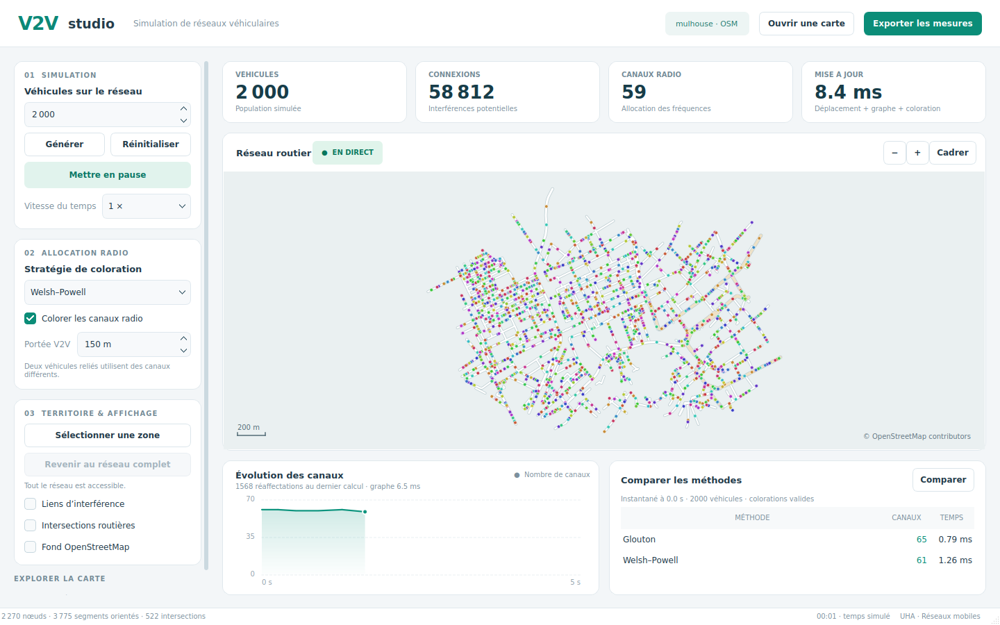

# Vérification après corrections — 29 octobre 2026

La version corrigée compile, les trois suites de tests passent en Release et avec AddressSanitizer / UndefinedBehaviorSanitizer, et les scénarios de crash identifiés ne se reproduisent plus. L'exécutable Linux a été mis à jour dans `build-linux/V2VSimulation`.

Le rapport qui décrivait les défauts avant intervention est conservé dans [docs/AUDIT_INITIAL.md](docs/AUDIT_INITIAL.md). Le présent rapport décrit la version livrée.

## Résultat de validation

| Contrôle | Résultat |
| --- | --- |
| Compilation complète C++17 / Qt 6 | Réussie |
| Suite `core` | 65 contrôles réussis, aucun échec |
| Suite `reload_map` | 5 contrôles réussis, aucun échec |
| Suite `gui_workflow` | 12 contrôles réussis, aucun échec |
| Total fonctionnel | **82 contrôles réussis** répartis dans trois suites CTest |
| Même suite avec ASan et UBSan | Trois suites réussies, aucune erreur d'accès mémoire ni de comportement indéfini signalée |
| Application complète instrumentée | Démarrage, simulation et capture hors écran réussis |
| Présentation | Captures de la vraie application vérifiées à 1 440 × 900 et 1 140 × 780 |

Les contrôles agrégés incluent 100 graphes aléatoires par méthode et 12 scénarios de latitude/projection comparés à un calcul haversine indépendant. Ils ne constituent pas un pourcentage de conformité universel.

Journaux finaux : [Release et benchmark](tests/audit/results/release-corrected.log), [ASan / UBSan](tests/audit/results/sanitizers-corrected.log). Les fichiers `release.log`, `sanitizers.log` et `initial-build-and-smoke.log` concernent l'audit initial, avant les corrections.

## Corrections réalisées

| Défaut initial | Correction et vérification |
| --- | --- |
| Crash au rechargement | Les tuiles sont retirées avant le nettoyage de la scène. Les requêtes en attente sont annulées et déconnectées ; une génération identifie les réponses périmées. Dix rechargements consécutifs, changements de fond et annulation de requêtes testés sous ASan. |
| Interférences oubliées selon le zoom | Remplacement de la grille en pixels par une grille 3D en mètres, indépendante du zoom et de la latitude. Les positions GPS sont converties une fois par véhicule. Tests aux latitudes −80°, 0°, 47,75° et 80°, aux projections 0, 10 et 18 et près de l'antiméridien. |
| État périmé après génération | Génération, remise à zéro, changement d'algorithme et portée actualisent le graphe et la coloration pendant la pause. L'effacement remet également les statistiques à zéro. Dessin avec vérification des indices. |
| Sélection sans effet | Découpage des segments aux limites de la sélection, placement et déplacements confinés, refus des zones sans route sans perdre la précédente. Test de 80 mises à jour accélérées avec maintien de tous les véhicules dans la zone. |
| Sens unique inversé | `oneway=-1` inverse l'ordre des références. Le sens unique des ronds-points tient compte d'une dérogation explicite, indépendamment de l'ordre des tags. |
| Intersections erronées | Comptage des voisins physiques distincts avec données mémorisées, seuil de trois voisins. Le jeu fourni compte maintenant 522 intersections, au lieu de 640 marqueurs selon l'ancienne règle. |
| Entrées invalides | Rejet des coordonnées absentes, non numériques, non finies ou hors limites Mercator et des fichiers sans route utilisable. Un échec de chargement conserve la carte précédente. |
| Comparaison incomplète | Calcul des deux méthodes sur un même instantané, validation explicite, horodatage et affichage des temps et nombres de canaux. |
| Absence d'analyse dans le temps | Historique des canaux, temps du graphe et changements de canaux, courbe et export CSV atomique. Export réussi et erreur d'écriture testés. |
| Interface chargée | Refonte claire avec panneau latéral, carte épurée, statistiques, courbe et comparaison. Liens masqués initialement, inspection d'un véhicule par clic, couches et cadrage accessibles. |

Les couleurs d'affichage dépendent désormais de l'identifiant du canal, et ne changent plus uniquement parce que le nombre total de canaux varie. Les deux méthodes restent des recolorations complètes ; le logiciel mesure les réaffectations effectives, sans prétendre les supprimer.

## Performance avec 2 000 véhicules

Mesure Release dans l'image Docker locale `v2v-build`, GCC 13.3, Qt 6.4.2, CMake 3.28.3. Données : Mulhouse, 2 270 nœuds, 3 775 segments orientés, projection zoom 15. Chaque méthode est mesurée sur 30 mises à jour, hors rendu.

| Méthode | Avant : moyenne | Après : moyenne | Après : 95e percentile | Après : coloration seule |
| --- | --- | --- | --- | --- |
| Glouton | 507,7 ms | **7,8 ms** | 9,1 ms | 0,8 ms |
| Welsh–Powell | 499,2 ms | **8,2 ms** | 9,0 ms | 1,4 ms |

La mise à jour est environ 60 fois plus rapide sur cette mesure. Les deux séries produisent environ 59 500 arêtes et des colorations valides. Une recherche exhaustive retrouve exactement les arêtes calculées par la grille à la fin de chaque série.

La comparaison sur le même instantané final de la première série donne 59 canaux pour le glouton et 55 pour Welsh–Powell ; sur celui de la seconde, 57 et 55. Ces exemples ne prouvent pas que Welsh–Powell gagne sur tous les graphes. La population initiale est fixée ; les choix de routes ultérieurs restent aléatoires, donc les valeurs peuvent varier entre exécutions.

Les temps dépendent de la machine, du nombre d'arêtes et de la portée. Ce benchmark mesure le calcul de simulation, pas les images par seconde de l'interface. Les graphes très denses gardent un nombre quadratique d'arêtes ; l'affichage de tous les liens a un coût supplémentaire.

## Interface livrée



[Voir la capture compacte](tests/audit/results/interface-compact.png).

La carte vectorielle reste utilisable sans connexion. Le panneau latéral défile sur les fenêtres moins hautes. L'interface démarre en pause avec 2 000 véhicules et permet d'ouvrir une autre carte, régler la portée, choisir une méthode, comparer et exporter.

## Compiler, lancer et retester

```bash
cmake --preset linux
cmake --build --preset linux -j 2
QT_QPA_PLATFORM=offscreen ctest --preset linux
./build-linux/V2VSimulation
```

Le [manuel utilisateur/développeur](README.md) donne les prérequis, les commandes Docker et Windows, l'architecture, les raccourcis, les définitions des indicateurs, le format CSV et les instructions de vérification mémoire.

## Documentation de projet

Le manuel contient une section sur l'assistance IAG utilisée dans cette session. Une [base de cahier des charges](docs/CAHIER_DES_CHARGES.md) et un [support de point intermédiaire](docs/POINT_INTERMEDIAIRE.md) sont fournis. Les noms, responsabilités, choix réels d'organisation et échéances internes du groupe doivent être personnalisés ; ils ne peuvent pas être déduits du code.

## Périmètre vérifié

Les tests utilisent les sources de production, de vraies scènes Qt et des tuiles en cache. Le réseau du conteneur est désactivé. L'annulation des requêtes est testée, mais le téléchargement réel de tuiles et la compilation/exécution Windows n'ont pas été vérifiés dans cet environnement Linux. La détection de fuites Qt est désactivée (`detect_leaks=0`) ; la validation ASan porte sur les accès mémoire.

Les captures vérifient le rendu hors écran ; les interactions principales sont exercées par les tests de workflow via les méthodes de la vue. Une recette sur l'écran et les machines de démonstration du groupe reste utile. Les scénarios testés sont corrigés ; aucun ensemble fini de tests ne garantit l'absence de tout défaut possible.
