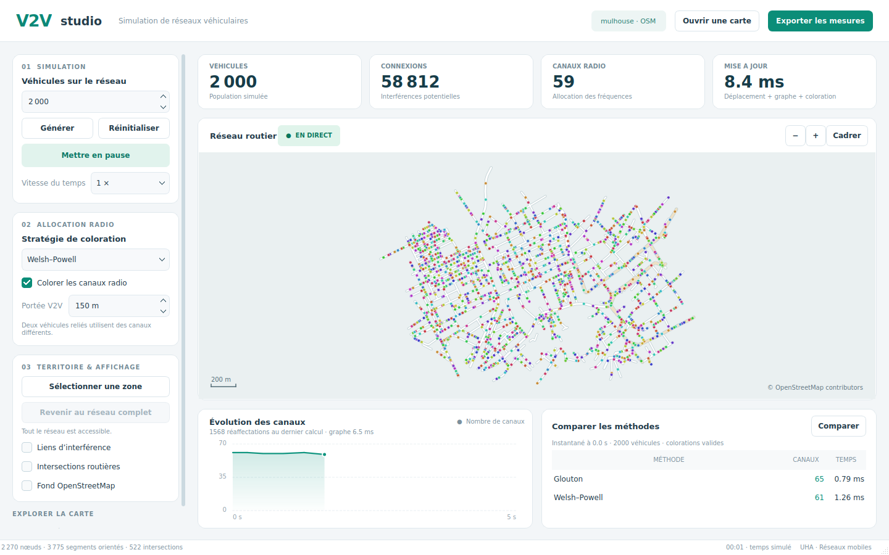

# V2V Studio

Application C++17 / Qt 6 de simulation des communications entre véhicules sur un réseau OpenStreetMap. Le jeu de données fourni couvre une partie de Mulhouse. La carte démarre avec 2 000 véhicules en pause.



## Utiliser l'application

- **Ouvrir une carte** charge un fichier `.osm` et construit le graphe routier. Une erreur de chargement conserve la simulation précédente.
- **Générer** applique le nombre de véhicules saisi, entre 1 et 5 000. Le placement est pondéré par la longueur des portions de route.
- **Démarrer / Mettre en pause** contrôle les déplacements. La vitesse du temps varie de 0,125× à 8×.
- **Réinitialiser** met en pause, replace la population actuelle et remet le temps et l'historique à zéro.
- **Stratégie de coloration** choisit le glouton ou Welsh–Powell. Les changements sont appliqués aussi pendant la pause.
- **Portée V2V** règle le rayon de transmission de tous les véhicules, entre 1 et 500 mètres.
- **Sélectionner une zone** permet de tracer un rectangle. Les véhicules sont replacés et restent sur les portions de routes comprises dans cette zone. Un véhicule qui atteint sa limite est réinséré sur une route de la sélection. Une zone sans route est refusée en conservant la précédente.
- **Revenir au réseau complet** enlève cette restriction et replace la population sur l'ensemble des routes.
- **Liens d'interférence**, **Intersections routières** et **Fond OpenStreetMap** contrôlent les couches visibles. Les liens et les intersections sont masqués au départ pour garder la carte lisible.
- Un **clic sur un véhicule** affiche sa portée et ses liens. Un clic ailleurs enlève cette sélection.
- **Comparer** exécute les deux méthodes sur exactement le même graphe, vérifie les colorations et indique le temps de cet instantané. La comparaison reste figée jusqu'au prochain clic ; les statistiques au-dessus de la carte continuent d'évoluer.
- **Exporter les mesures** écrit l'historique récent et une nouvelle comparaison dans un fichier CSV.

La molette zoome, un glissement déplace la carte et **Cadrer** retrouve la vue complète. Le panneau de gauche défile si la hauteur de la fenêtre est réduite.

| Raccourci | Action |
| --- | --- |
| Espace | Démarrer / pause |
| R | Réinitialiser |
| F | Cadrer la carte |
| Ctrl+O | Ouvrir un fichier OSM |
| Ctrl+S | Exporter les mesures |

## Lire les mesures

Le nombre de connexions représente les paires pouvant interférer. Il ne représente pas un nombre de paquets ou un débit radio. Une arête existe si la distance est strictement inférieure à la portée d'au moins un des deux véhicules. L'interface applique une portée commune à la population.

Les canaux sont des identifiants de coloration. Deux véhicules reliés reçoivent des identifiants différents. Chaque identifiant conserve sa couleur visuelle lorsque le nombre total change ; deux teintes proches peuvent toutefois être difficiles à distinguer avec beaucoup de canaux. Les algorithmes sont heuristiques et ne garantissent pas un minimum global.

La durée de mise à jour comprend le déplacement, la construction du graphe et la coloration active, hors rendu. Le nombre de réaffectations compte les changements d'identifiants depuis le calcul précédent pour la même population. Il sert à étudier la stabilité ; le logiciel n'impose pas une allocation sans changement.

La courbe montre la dernière minute simulée à partir de l'historique conservé, limité à 3 600 échantillons. Le CSV conserve ces échantillons, avec les colonnes `time_s`, `vehicles`, `edges`, `algorithm`, `colors`, `graph_ms`, `coloring_ms`, `update_ms`, `changed_channels`. Les lignes `comparison` ajoutent la validation des deux résultats sur leur instantané commun. Les nombres CSV utilisent un point décimal ; les champs non mesurés restent vides.

## Compiler et lancer

Prérequis : compilateur C++17, CMake 3.16 ou plus récent, Qt 6 avec Widgets et Network, et pugixml avec sa configuration CMake. Ninja est utilisé dans les commandes ci-dessous. CTest construit et lance les tests ; il est activé par défaut.

### Linux

Avec les dépendances de développement installées :

```bash
cmake --preset linux
cmake --build --preset linux -j 2
QT_QPA_PLATFORM=offscreen ctest --preset linux
./build-linux/V2VSimulation
```

Pour compiler sans preset :

```bash
cmake -S . -B build-linux -G Ninja -DCMAKE_BUILD_TYPE=Release
cmake --build build-linux -j 2
```

Le fichier `mulhouse.osm` est recherché dans `data/` à côté de l'exécutable, dans `../data/`, dans le répertoire de travail, puis dans le dossier utilisé à la compilation. On peut aussi ouvrir un fichier depuis l'interface.

### Docker

L'image prépare le compilateur et les dépendances ; l'interface reste une application desktop. Voir aussi [README-docker.md](README-docker.md).

```bash
docker build -t v2v-build .
docker run --rm -v "$PWD":/workspace v2v-build ./scripts/docker-build.sh
docker run --rm --network none -v "$PWD":/workspace v2v-build \
  env QT_QPA_PLATFORM=offscreen ctest --test-dir build-linux --output-on-failure
```

### Windows

Utiliser Qt 6 pour MSVC et un pugixml construit pour le même compilateur. Fournir leurs chemins CMake avec `CMAKE_PREFIX_PATH` et/ou le fichier toolchain vcpkg. Le preset `default` conserve le chemin vcpkg du projet, à adapter à l'installation. Le chemin Qt historique dans `CMakeLists.txt` est également spécifique à cette installation. Les options MSVC activent C++17 et UTF-8.

```powershell
cmake -S . -B build -DCMAKE_PREFIX_PATH="C:/Qt/<version>/msvc2022_64" -DCMAKE_TOOLCHAIN_FILE="C:/dev/vcpkg/scripts/buildsystems/vcpkg.cmake"
cmake --build build --config Release
ctest --test-dir build -C Release --output-on-failure
```

Déployer les bibliothèques Qt nécessaires avec `windeployqt` à côté de l'exécutable Windows et fournir le dossier `data`. La version Windows n'a pas été exécutée durant cette vérification Linux.

## Architecture et algorithmes

| Fichier | Rôle |
| --- | --- |
| `OsmParser` | Valide les coordonnées et extrait les routes carrossables ; prend en charge les sens uniques inversés et les ronds-points. |
| `RoadGraph` | Construit les segments orientés et leur longueur GPS ; mémorise les voisins distincts pour identifier les intersections. |
| `VehicleSimulation` | Place et déplace les véhicules, découpe les segments aux limites de la sélection, synchronise le graphe et la coloration. |
| `InterferenceGraph` | Convertit une fois les positions en coordonnées cartésiennes terrestres ; utilise une grille 3D en mètres puis une distance sphérique exacte. |
| `GraphColoring` | Coloration gloutonne, ou tri par degré décroissant puis coloration gloutonne ; validation des résultats et palette stable par identifiant. |
| `TileLayer` | Cache et chargement asynchrone des tuiles ; annulation des requêtes lors d'un changement de carte. |
| `MapView` | Interactions avec la carte, couches, rendu groupé des véhicules, historique et export atomique du CSV. |
| `HistoryChart`, `main` | Courbe, panneaux de commandes, statistiques et comparaison. |

Le glouton traite les véhicules dans l'ordre de leurs indices. Welsh–Powell les traite par degré décroissant, avec un départage déterministe par indice. Un tableau de marques évite de recréer une table de hachage pour chaque sommet.

La grille 3D utilise la longueur de la corde correspondant à la portée comme taille de cellule. Toute paire dans la portée se trouve dans des cellules voisines selon les trois axes. La comparaison finale convertit la corde en distance sphérique. Le coût dépend de la densité ; un graphe presque complet conserve un nombre quadratique d'arêtes.

Les nœuds OSM intermédiaires restent des sommets du réseau pour conserver la géométrie des routes. Une intersection possède au moins trois voisins physiques distincts, indépendamment du découpage des routes OSM.

## Vérifier les corrections

```bash
QT_QPA_PLATFORM=offscreen ctest --test-dir build-linux --output-on-failure
QT_QPA_PLATFORM=offscreen ./build-linux/tests/audit/V2VAudit benchmark
```

Sous GCC/Clang, une configuration séparée active les contrôles d'accès mémoire et de comportement indéfini :

```bash
cmake -S . -B build-sanitizers -G Ninja -DCMAKE_BUILD_TYPE=Debug \
  -DV2V_SANITIZERS=ON -DAUDIT_SANITIZERS=ON
cmake --build build-sanitizers -j 2
QT_QPA_PLATFORM=offscreen UBSAN_OPTIONS=halt_on_error=1 \
  ctest --test-dir build-sanitizers --output-on-failure
```

CTest définit `ASAN_OPTIONS=detect_leaks=0` pour ces tests Qt : les accès mémoire sont vérifiés, mais cette exécution ne constitue pas une recherche de fuites.

Pour produire une capture de la vraie interface sans serveur de tuiles :

```bash
QT_QPA_PLATFORM=offscreen ./build-linux/V2VSimulation --offline --screenshot /tmp/v2v.png
```

`--compact` vérifie aussi le format réduit. Le mode capture fait tourner brièvement les 2 000 véhicules puis ferme l'application. `--offline` seul permet d'utiliser le réseau vectoriel sans télécharger de tuiles.

Les résultats et limites de validation sont détaillés dans [RAPPORT_VERIFICATION.md](RAPPORT_VERIFICATION.md).

## Usage des IAG

Une assistance IAG a été utilisée pour auditer cette version du projet, proposer et réaliser des corrections C++/Qt, optimiser les interférences et la coloration, remanier l'interface, écrire les tests et préparer la documentation. Les tests exécutent les fichiers de production ; les contrôles comprennent un calcul de référence indépendant pour les distances et les interférences.

Cette section décrit l'assistance de la session de correction ; elle ne permet pas d'établir l'origine du code antérieur. Avant la remise, le groupe doit compléter son propre bilan d'usage des IAG et savoir expliquer le code qu'il présente.
